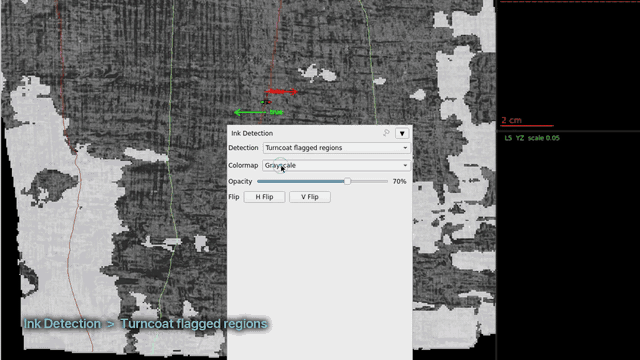
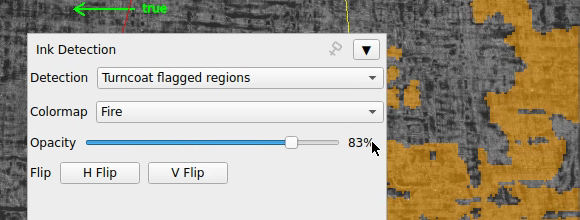
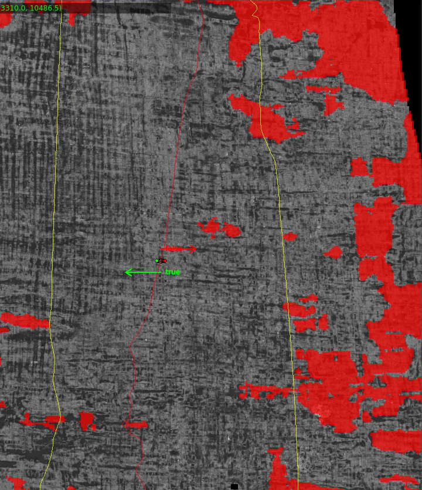
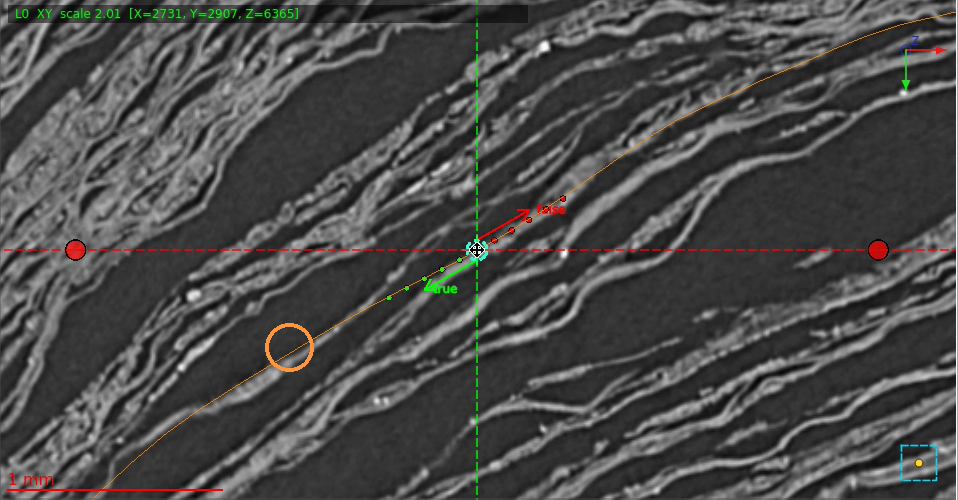
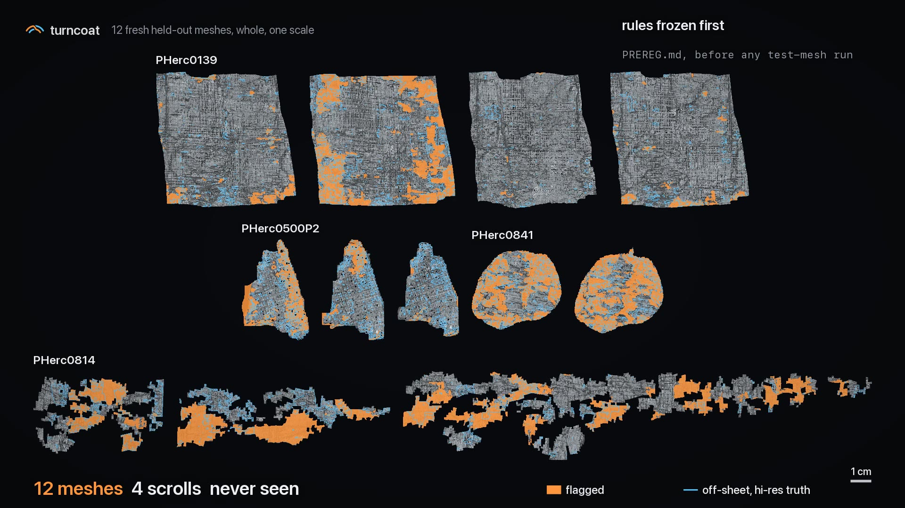

# Turncoat

**Finds the places where a traced scroll segment slips onto the wrong sheet, and shows them in VC3D.**



**Video (1:55):** [docs/turncoat.mp4](docs/turncoat.mp4)

## Install and run

```bash
git clone https://github.com/gmunhoz0810/turncoat && pip install ./turncoat

turncoat check SEGMENT --volume SCAN_URL --write-to-segment
```

`SEGMENT` is a tifxyz folder (`x.tif`, `y.tif`, `z.tif`, `meta.json`), `SCAN_URL` the open-data scan it was traced on.
The run is CPU only (a whole PHerc0139 segment: about 15 min on a laptop, under 3.5 GB RAM). It needs the segment's
dinovol embeddings in `SEGMENT/turncoat/embeddings.npz`, made once on a GPU (see [Embeddings](#embeddings)).

## See it in VC3D (stock, no plugin)

1. Open your project in VC3D and select the segment.
2. Open the **Ink Detection** dock. Pick **Turncoat flagged regions**, Colormap **Fire**, opacity up (80-100 %): flagged
   regions show in orange. (**Turncoat switch likelihood** is the continuous 0-1 map.)
3. Ctrl+click a flagged border: the slice views jump there and show where the trace changes sheet.

| 1. Turncoat layer, Colormap: Fire | 2. flagged regions (orange) on the segment | 3. the slices at a flagged border after ctrl+click |
|---|---|---|
|  |  |  |

`--write-to-segment` adds `turncoat_flagged.png`, `turncoat_switch_likelihood.png` and their entries in the segment's
`ink-detections.json` (entries from other tools are kept), plus `switch_likelihood.tif` / `suspicion.tif` surface
channels. `SEGMENT/turncoat/regions.json` ranks the regions, largest and surest first.

## Evidence



| test | measured on | Turncoat F1 (R / P) | tifxyz-doctor F1 (R / P) |
|---|---|---|---|
| node exact, hi-res truth | 12 held-out meshes, 4 scrolls, 449,811 scored nodes | **0.537** (47.8 / 61.4) | 0.032 (1.6 / 71.6) |
| outside check: fibre pairs | 22,662 two-sheet node pairs from automatic fibres | **0.234** (14.0 / 69.9) | 0.041 (2.1 / 66.3) |
| outside check: verified nodes | 3,614 nodes where truth and fibres agree (1,246 off-sheet) | **0.416** (38.3 / 45.6) | 0.020 (1.0 / 41.9) |

Per scroll (node exact, F1, Turncoat / tifxyz-doctor):

| PHerc0139 (4 meshes) | PHerc0500P2 (3) | PHerc0814 (3) | PHerc0841 (2) |
|---|---|---|---|
| 0.499 / 0.002 | 0.461 / 0.090 | 0.470 / 0.006 | 0.768 / 0.074 |

- **Truth:** each node's sheet, traced automatically on the same segment's registration on its scroll's 2.2-2.4 µm scan,
  where sheets are resolved; a node is off-sheet when it is not on the majority sheet of its spiral turn.
- **Outside check:** automatic fibres (AFV fibre model V2 and the AVF spline generator, pinned Hugging Face revisions),
  independent of Turncoat, in 84 random 256³ regions of the hi-res scans.
- **Split:** the rule was fitted on 2 dev meshes only (PHerc0139 w045, w046; F1 0.906) and frozen in
  [PREREG.md](PREREG.md) before one scoring run on the 12 test meshes.
- **Reproduce:** `python evidence/score.py` recomputes every number above from the stored counts in `evidence/`.

## Benchmark

The per-node labels of all 14 meshes, the fibre pairs and a scorer are in [bench/](bench/): score your own detector
with `turncoat bench score --flags DIR`, or inspect our truth in VC3D.

## How it works

- **dinovol embeddings** (the organisers' public model) are sampled along every node normal of the segment.
- **A robust least-squares tracker** finds, per node, how far the segment sits from the segment's main sheet in that
  embedding, in layers.
- **Region rule:** nodes at least 0.3 layers off form regions; a region is kept from 1 mm² up if Turncoat's `leave`
  / `step` alarms (where the trace leaves its sheet in the organisers' surface prediction) support it.
- **Output:** a ranked region list, two maps, and the VC3D files above.

## Limits

- Recall is about half: 52 % of off-sheet nodes on the held-out meshes are not flagged.
- On nearly clean segments a large share of flags are false (PHerc0139 w025: 129 of 197 flagged scored nodes).
- The truth is checked against human-guided fibres only on PHerc0139; on the other three scrolls it agrees with the
  automatic fibres on 76 % of related node pairs.

## Embeddings

On a CUDA machine (about 4-15 min per segment on one RTX 4090):

```bash
pip install "./turncoat[gpu]"
git clone https://github.com/ScrollPrize/villa && pip install -e villa/dinovol
curl -L -o teacher_step_640000.pt \
  https://huggingface.co/scrollprize/dinovol_8um_ps192_102126/resolve/main/teacher_step_640000.pt
turncoat embed SEGMENT --volume SCAN_URL --ckpt teacher_step_640000.pt   # writes SEGMENT/turncoat/embeddings.npz
```

## License

MIT. See [LICENSE](LICENSE).
